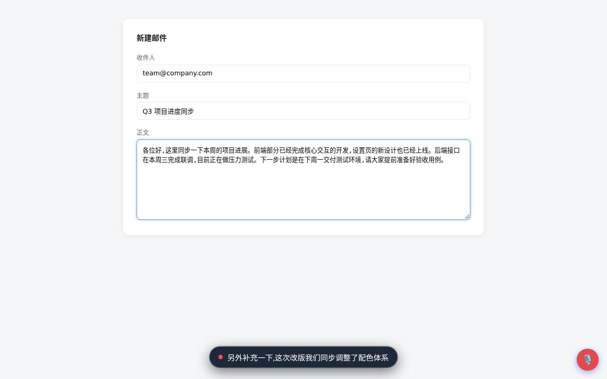

# CrostiVoice 🎙

**ChromeOS 语音输入扩展** — 点一下快捷键说话,智能断句、同音字纠错,文字自动上屏。

[English](#english) · 简体中文

---

## 为什么做这个

ChromeOS 上打中文依赖系统拼音,长句输入慢、纠错繁琐。CrostiVoice 把「说话」变成第一输入方式:按一下 `Search+A`,说完停顿,整理好的文字直接出现在光标里。

核心能力全部**本地运行**:

- **神经标点断句** — 内置 CT-Transformer 模型(74MB),毫秒级,逗号句号问号位置由语义决定
- **同音字纠错** — 内置 macbert4csc 模型(101MB),「一至→一致」「害帕→害怕」自动纠正
- **热词词典** — 人名、术语、品牌名的专属纠错表
- **中英混排** — 自动加空格、英文句首大写
- **规则引擎兜底** — 未下载模型时,规则断句依然工作

不收集任何数据,无账号,无遥测。[隐私政策 →](https://pmparker.net/crostivoice/privacy/)




## 安装

### 方式一:下载 Release(推荐)

1. 从 [Releases](https://github.com/pm-parker/crostivoice/releases) 下载 `CrostiVoice_vX.X.X.zip` 并解压
2. Chrome 打开 `chrome://extensions`,开启右上角「开发者模式」
3. 「加载已解压的扩展程序」→ 选择解压出的文件夹
4. 引导页弹出后点击「授权麦克风」(只需一次)

### 方式二:从源码

```bash
git clone https://github.com/pm-parker/crostivoice.git
# Chrome → chrome://extensions → 开发者模式 → 加载已解压的扩展程序 → 选择仓库目录
```

## 使用

| 操作 | 效果 |
|---|---|
| **点一下** `Search+A` | 开始说话,浮层实时显示识别文字 |
| **说完停顿 ~1.5 秒** | 自动断句加标点,填入光标所在输入框 |
| **说完立刻再点一下** | 不等停顿,立即上屏 |
| 右下角 🎙 浮动按钮 | 同样点一下开始(不依赖快捷键) |

> ⚠️ ChromeOS 注意:**不要长按**搜索键(会触发系统 Assistant)。支持**点按**。
>
> 快捷键可在 `chrome://extensions/shortcuts` 修改;也提供 `Alt+A` 点按模式。

### 进阶

- **热词词典**:设置 → 我的词典,添加 `错词 -> 正确写法`,识别自动纠正
- **标点风格**:中文 `,。?` / 英文 `, . ?`(写代码注释友好)
- **简繁输出** / **深度整理**(需 Chromebook Plus 的内置 AI,可选)

## 隐私

语音识别由 Chrome 浏览器内置服务完成;文字整理由本机模型离线推理;历史与词典仅存本机。无账号、无遥测、无上传。详见 [隐私政策](PRIVACY.md)。

## 系统要求

- ChromeOS / Chrome 116+(本地 AI 需要 Chrome 121+)
- 麦克风权限

## 技术栈

Manifest V3 · Web Speech API · ONNX Runtime Web (WASM) · Transformers.js · Shadow DOM

```
manifest.json      MV3 清单
background.js      Service Worker:状态机、快捷键路由、模型管理
offscreen.js       Offscreen 文档:语音识别 + 智能断句管线
punct-engine.js    本地神经标点引擎(CT-Transformer int8)
csc-engine.js      本地语义纠错引擎(macbert4csc int8)
content.js         内容脚本:焦点跟踪、文字注入、Shadow DOM 浮层
options/           设置页(Linear 风格,双主题)
vendor/            ONNX Runtime Web 运行时(模型按需下载)
```

## 致谢

- [rime-ice 雾凇拼音](https://github.com/iDvel/rime-ice) 与 [rime-ice-installer](https://github.com/manateelazycat/rime-ice-installer) — 词库与配置理念
- [Talvio](https://github.com/ishangautam7/Talvio) — 产品形态启发
- [sherpa-onnx](https://github.com/k2-fsa/sherpa-onnx) / 阿里达摩院 CT-Transformer — 标点模型
- [shibing624/macbert4csc](https://github.com/shibing624/pycorrector) — 纠错模型
- [Transformers.js](https://github.com/huggingface/transformers.js) — 浏览器推理运行时

## License

MIT

---

<a name="english"></a>

# CrostiVoice (English)

**Voice dictation for ChromeOS** — tap a shortcut, speak, and properly punctuated text lands at your cursor.

Key features (all on-device):

- **Neural punctuation** — bundled CT-Transformer model (74MB), millisecond inference
- **Homophone correction** — macbert4csc (101MB) fixes `yizhi → 一致`-style mistakes
- **Personal dictionary**, CN/EN punctuation styles, Simplified/Traditional output
- Zero telemetry, no accounts, offline-first

### Install

Download from [Releases](https://github.com/pm-parker/crostivoice/releases), unzip, then `chrome://extensions` → Developer mode → Load unpacked.

### Use

Tap `Search+A` (ChromeOS) to start, pause when done — text auto-inserts. Tap again to finish immediately. Floating mic button works too.

See [PRIVACY.md](PRIVACY.md) for the full privacy policy.
