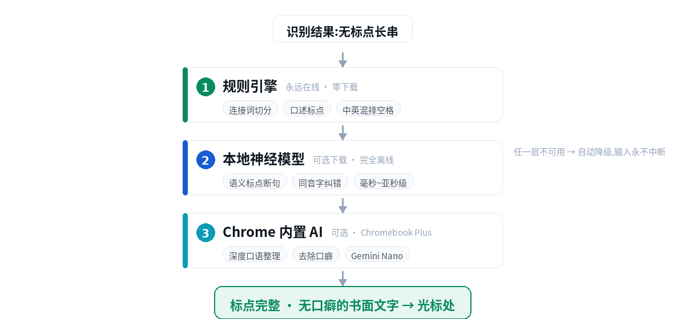
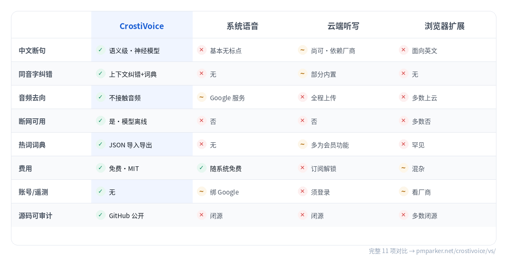

<div align="center">

<a name="zh-cn"></a>


[](https://github.com/pm-parker/crostivoice/releases) [](LICENSE) [](#系统要求) [](https://pmparker.net/crostivoice/privacy/)

**点一下快捷键说话,本地 AI 断句纠错,文字自动上屏。**

[官网(中文)](https://pmparker.net/crostivoice/) · [Website (EN)](https://pmparker.net/crostivoice/en/) · [为什么不用云端方案?](https://pmparker.net/crostivoice/vs/) · [开发手记](https://pmparker.net/blog/crostivoice-voice-typing.html) · [English](#english)


**下载安装 → [Releases](https://github.com/pm-parker/crostivoice/releases)** · 三步装完,即开即用

---

</div>

## 为什么做这个

ChromeOS 上打中文依赖系统拼音,长句输入慢、纠错繁琐。CrostiVoice 把「说话」变成第一输入方式:点一下 `Search+A`,说完停顿,整理好的文字直接出现在光标里。

核心能力**全部本地运行**:

- **神经标点断句** — 内置 CT-Transformer 模型(74MB,可选下载),毫秒级,标点位置由语义决定
- **同音字纠错** — 内置 macbert4csc 模型(101MB,可选下载),「一至→一致」「害帕→害怕」自动纠正
- **热词词典** — 人名、术语、品牌名的专属纠错表,JSON 导入导出
- **中英混排** — 自动加空格、英文句首大写;支持简中/繁中/英/日/韩
- **规则引擎兜底** — 不下载模型也能用,所有层级自动降级,输入永不中断

## 工作原理:三层文本管线

<div align="center">

</div>

> 语音识别只是原料。每句话按成本从低到高经过三层处理,任何一层不可用自动降级到下一层——**输入永不中断**。

## 对比:为什么不用系统输入法 / 云端方案?

<div align="center">



**[完整 11 项对比 →](https://pmparker.net/crostivoice/vs/)**

</div>

## 安装

**方式一:下载 Release(推荐)**

1. 从 [Releases](https://github.com/pm-parker/crostivoice/releases) 下载 `CrostiVoice_vX.X.X.zip` 并解压
2. Chrome 打开 `chrome://extensions`,开启右上角「开发者模式」
3. 「加载已解压的扩展程序」→ 选择解压出的文件夹
4. 引导页弹出后点击「授权麦克风」(只需一次)

> 装完即可用(规则引擎兜底);想要语义级断句与纠错,再到设置页下载两个模型(74MB + 101MB,仅一次,之后完全离线)。

**方式二:从源码**

```bash
git clone https://github.com/pm-parker/crostivoice.git
# Chrome → chrome://extensions → 开发者模式 → 加载已解压的扩展程序 → 选择仓库目录
```

## 使用

| 操作 | 效果 |
|---|---|
| **点一下** `Search+A` | 开始说话,浮层实时显示识别文字 |
| **说完停顿 ~1.5 秒** | 自动断句加标点,填入光标所在输入框 |
| **说完立刻再点一下** | 不等停顿,立即上屏 |
| 右下角 🎙 浮动按钮 | 同样点一下开始(不依赖快捷键) |

> ⚠️ ChromeOS 注意:**不要长按**搜索键(会触发系统 Assistant)。支持**点按**。快捷键可在 `chrome://extensions/shortcuts` 修改;也提供 `Alt+A` 点按模式。

### 进阶

- **热词词典**:设置 → 我的词典,添加 `错词 -> 正确写法`,识别自动纠正
- **标点风格**:中文 `,。?` / 英文 `, . ?`(写代码注释友好)
- **简繁输出** / **深度整理**(需 Chromebook Plus 的内置 AI,可选)
- **数据迁移**:设置 → 数据,配置与词典导出为 JSON,换设备一次带入

## 常见问题

<details>
<summary><b>我的语音会上传到你的服务器吗?</b></summary>

不会——CrostiVoice 根本没有服务器。识别由 Chrome 内置语音服务完成,扩展不接触原始音频;断句与纠错模型在本机推理;历史与词典只存本地。[源码公开](https://github.com/pm-parker/crostivoice),可审计。
</details>

<details>
<summary><b>必须下载 175MB 的 AI 模型才能用吗?</b></summary>

不必须。装完即可用(规则引擎);模型是可选升级,下载一次后完全离线,可随时删除。
</details>

<details>
<summary><b>为什么是「点一下」而不是「按住说话」?</b></summary>

ChromeOS 把「长按搜索键」保留给系统 Assistant,扩展拿不到这个事件。实测点按反而更顺手:边想边说,停顿即上屏。更多问题见 [官网 FAQ →](https://pmparker.net/crostivoice/#faq)
</details>

## 隐私

**零遥测 · 零上传 · 零账号。** 语音识别由 Chrome 浏览器内置服务完成;文字整理由本机模型离线推理;历史(最近 50 条)与词典仅存本机,可随时清空或导出。详见[隐私政策](https://pmparker.net/crostivoice/privacy/)。

## 系统要求

- ChromeOS / Chrome 116+(本地 AI 需要 Chrome 121+)
- 麦克风权限

## 技术栈

Manifest V3 · Web Speech API · ONNX Runtime Web (WASM) · Transformers.js · Shadow DOM

```
manifest.json      MV3 清单
background.js      Service Worker:状态机、快捷键路由、模型管理
offscreen.js       Offscreen 文档:语音识别 + 智能断句管线
punct-engine.js    本地神经标点引擎(CT-Transformer int8)
csc-engine.js      本地语义纠错引擎(macbert4csc int8)
content.js         内容脚本:焦点跟踪、文字注入、Shadow DOM 浮层
options/           设置页(Linear 风格,双主题)
vendor/            ONNX Runtime Web 运行时(模型按需下载)
```

## 文档与链接

| 资源 | 链接 |
|---|---|
| 官网(中文) | https://pmparker.net/crostivoice/ |
| Website (English) | https://pmparker.net/crostivoice/en/ |
| 方案对比 | https://pmparker.net/crostivoice/vs/ |
| 隐私政策 | https://pmparker.net/crostivoice/privacy/ |
| 开发手记(完整踩坑记录) | https://pmparker.net/blog/crostivoice-voice-typing.html |
| 问题反馈 | https://github.com/pm-parker/crostivoice/issues |

## 致谢

- [rime-ice 雾凇拼音](https://github.com/iDvel/rime-ice) 与 [rime-ice-installer](https://github.com/manateelazycat/rime-ice-installer) — 词库与配置理念
- [Talvio](https://github.com/ishangautam7/Talvio) — 产品形态启发
- [sherpa-onnx](https://github.com/k2-fsa/sherpa-onnx) / 阿里达摩院 CT-Transformer — 标点模型
- [shibing624/macbert4csc](https://github.com/shibing624/pycorrector) — 纠错模型
- [Transformers.js](https://github.com/huggingface/transformers.js) — 浏览器推理运行时

## License

MIT

---

<div align="center">

<a name="english"></a>


**Tap a shortcut, speak — on-device AI punctuates, corrects, and inserts.**

[Website](https://pmparker.net/crostivoice/en/) · [中文官网](https://pmparker.net/crostivoice/) · [Why not cloud?](https://pmparker.net/crostivoice/vs/) · [简体中文](#zh-cn)

</div>

## Why CrostiVoice

Typing Chinese on ChromeOS means pinyin for everything — slow for long sentences, tedious to correct. CrostiVoice makes **speaking** the primary input method. Everything runs **on-device**:

- **Neural punctuation** — CT-Transformer model (74MB, optional download)
- **Homophone correction** — macbert4csc (101MB, optional) fixes sound-alike mistakes from context
- **Personal dictionary** — names & jargon, JSON import/export
- **Mixed CN/EN** — auto-spacing, sentence capitalization; zh-Hans/zh-Hant/EN/JA/KO
- **Rule engine fallback** — works with zero downloads, graceful degradation

<div align="center">

</div>

## Compare


**[Full 11-point comparison →](https://pmparker.net/crostivoice/vs/)**

## Install

Download from [Releases](https://github.com/pm-parker/crostivoice/releases), unzip, then `chrome://extensions` → Developer mode → **Load unpacked**. Grant microphone access on the welcome page (once).

> Works out of the box (rule engine). For semantic-level punctuation & correction, download the two models in settings (74MB + 101MB, one-time, fully offline afterwards).

## Use

Tap `Search+A` (ChromeOS) to start; pause ~1.5s when done and text auto-inserts; tap again to insert immediately. Floating mic button works without the keyboard. Don't **long-press** the Search key — that opens the Assistant; tap, don't hold. Shortcut customizable at `chrome://extensions/shortcuts`; `Alt+A` tap-mode also available.

## Privacy

**Zero telemetry · zero uploads · zero accounts.** Recognition via Chrome's built-in speech service (the extension never touches raw audio); text processing runs on-device; history (last 50) and dictionary stay local — clear or export anytime. [Full policy →](https://pmparker.net/crostivoice/privacy/)

## Requirements

ChromeOS or desktop Chrome 116+ (local AI needs 121+), microphone access.

## Links

| Resource | URL |
|---|---|
| Website (EN) | https://pmparker.net/crostivoice/en/ |
| 中文官网 | https://pmparker.net/crostivoice/ |
| Comparison | https://pmparker.net/crostivoice/vs/ |
| Privacy policy | https://pmparker.net/crostivoice/privacy/ |
| Issues | https://github.com/pm-parker/crostivoice/issues |

## Acknowledgements

- [rime-ice](https://github.com/iDvel/rime-ice) — lexicon & configuration philosophy
- [Talvio](https://github.com/ishangautam7/Talvio) — product inspiration
- [sherpa-onnx](https://github.com/k2-fsa/sherpa-onnx) / Alibaba CT-Transformer — punctuation model
- [shibing624/macbert4csc](https://github.com/shibing624/pycorrector) — correction model
- [Transformers.js](https://github.com/huggingface/transformers.js) — in-browser inference

## License

MIT
